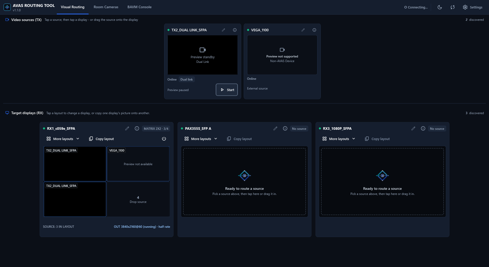
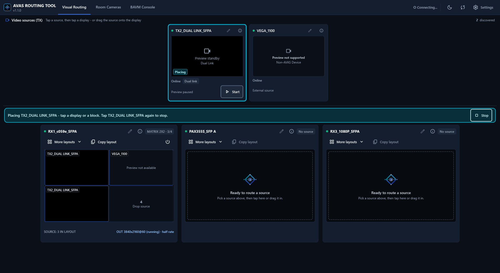
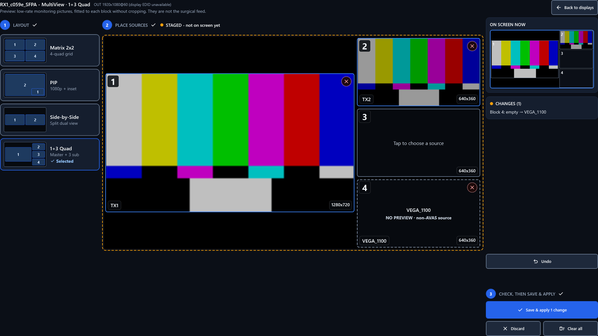
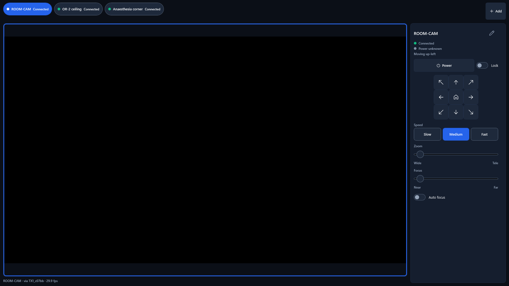
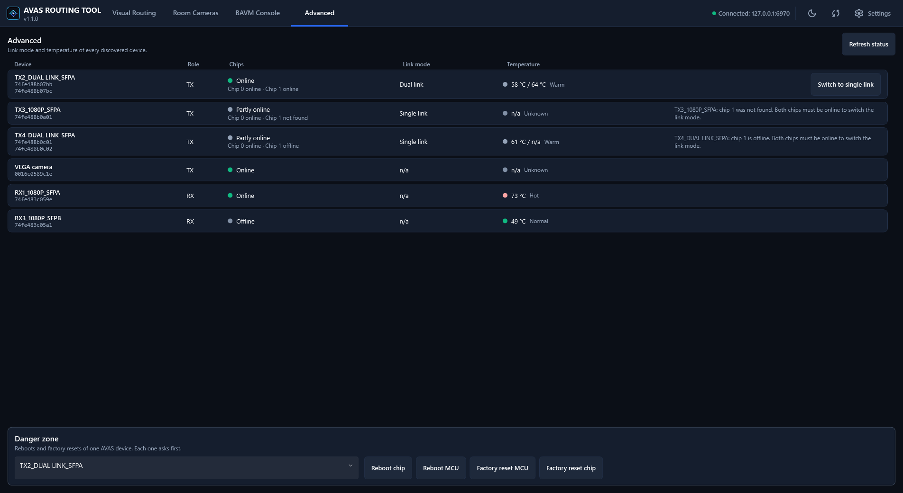

# AVAS Routing Tool v1.1.0

> [!CAUTION]
> **Prerequisite Required Before Launching**:
> AVAS Routing Tool requires an installed and running **BlueRiver AV Manager** (or BlueRiver Control Server) on your network to discover, route, and configure devices.
>
> 📥 **Download Required Installer**: [**BlueRiver_AV_Manager_2.1.0.1_b1375_windows.exe**](https://advantecho365-my.sharepoint.com/:u:/g/personal/mark_leorna_advantech_com/IQBvIY-m0EaXQ793kQU0Hc2GARNZTrC8_I89nw6T6Navbec?e=TnTEt2)
>
> **Please install and start BlueRiver AV Manager before launching the AVAS Routing Tool.**

> [!TIP]
> 🌐 **Product Overview & Demo**:
> To learn more about the complete architecture, features, and visual overview of this software, visit the interactive showcase page:
> 👉 [**AVAS Routing Tool Overview & Demo**](https://themarkl-corp.github.io/AVAS-Demo-Kit/routing-tool.html)

---

# Quick Start Guide

**Version 1.1.0** • Advantech AVAS-2 Series (AVAS-212S / AVAS-223) • Windows 10/11 (64-bit)

The AVAS Routing Tool is a Windows application for controlling video in the operating room. You pick a video source (for example an endoscope or a room camera) and send it to a surgical display. You can also split one display into several pictures (MultiView), and control room cameras from the same window.

It works with Advantech AVAS transmitters (TX) and receivers (RX), which are built on the Semtech BlueRiver SDVoE platform.

---

## 1. Before You Start

You need:

| Item | Details |
|---|---|
| Computer | Windows 10 or 11, 64-bit. Touch screens are supported. |
| Network | The computer must be on the same network subnet as your AVAS devices and the BlueRiver Control Server. |
| BlueRiver Control Server | Installed, running, and reachable. By default the app expects it on `localhost` (port 80 / REST 8080 / Telnet 6970). |
| Installed software | None other than BlueRiver AV Manager. The portable package contains all dependencies. |

---

## 2. Install and Launch

The app is fully portable:
1. Download and extract **`AvasRoutingTool-v1.1.0-portable-win-x64.zip`** to any directory (e.g. `C:\AVAS\`).
2. Ensure BlueRiver AV Manager is running.
3. Open the folder and double-click **`AvasRoutingTool.exe`**.
4. The app opens and immediately begins discovering AVAS devices.

*(To uninstall, simply close the app and delete the folder.)*

> **Note**: If Windows Defender / SmartScreen or your firewall prompts for permission on first launch, allow access. Network communication is required to discover devices, control routes, and receive real-time RTP previews.

---

## 3. First-Time Setup (2 minutes)

Default settings suit most installations:
1. Click **Settings** in the top-right corner.
2. Verify or update:
   - **BAVM Web Management URL**: `http://localhost:80` (or `http://<server-ip>:80` if running on a separate machine).
   - **REST API Port**: `8080`.
   - **Telnet Control Port**: `6970`.
   - **Multicast Pool Range**: `225.0.0.1` to `225.0.1.254`.
3. Click **Save & Apply**.

*Optional*: Enable **Show Logs tab (diagnostics)** or **Show Advanced tab (maintenance)** in Settings if needed.

---

## 4. Main Window Overview

- **Visual Routing**: Send video sources to surgical displays and manage layouts.
- **Room Cameras**: Direct PTZ controls (Pan, Tilt, Zoom, Focus) and preview for room cameras.
- **BAVM Console**: Embedded BlueRiver AV Manager web interface.
- **Logs**: Real-time diagnostic message feed (when enabled in Settings).
- **Advanced**: Device link mode, temperature monitoring, and device reboot/reset controls (when enabled in Settings).

---

## 5. Routing a Video Source

On the **Visual Routing** tab, sources (TX) are shown along the top strip and displays (RX) are displayed in the carousel below.

- **Tap & Tap**: Click or tap a source card, then click or tap the target display card.
- **Drag & Drop**: Click/touch and drag any source card directly onto the target display.
- **Turn Off**: Press **Turn Off** on a display card, or drag the **Off** tile onto the display.
- **Refresh**: Click **Refresh** in the top bar anytime to synchronize with the hardware's actual state.

---

## 6. MultiView (Split Display Layouts)

MultiView splits a display into multiple video blocks:
- **Matrix 2x2**: 4 equal quadrants.
- **Picture-in-Picture (PiP)**: Full 1920x1080 canvas with a 640x360 inset.
- **Side by Side**: Two 50% split feeds.
- **1+3 Quad**: One primary feed with 3 smaller tiles.

**To build a layout in the Composer:**
1. Select a layout preset on the left rail.
2. Select a source from the top strip and assign it into an empty block.
3. Review staged changes in the interactive canvas.
4. Click **Save & Apply** to push live to the surgical screen.

---

## 7. Room Cameras (PTZ)

1. Open the **Room Cameras** tab and click **Add a camera**.
2. Enter camera name, IP address, and port (use **Detect** or set UDP/TCP).
3. Select preview stream: **TX live preview** (AVAS device) or direct **RTSP stream**.
4. Test connection and click **Save**.
5. Use directional controls (hold-to-move), zoom/focus toggles, speed sliders, and power switch to operate.

---

## 8. Advanced Tab & Maintenance

Enable it in Settings with **Show Advanced tab (maintenance)**. It lists every discovered device with its role, chips, link mode and temperature.

The **Danger zone** provides **Reboot chip**, **Reboot MCU**, **Factory reset MCU**, and **Factory reset chip** for AVAS hardware.

---

## 9. What's New in v1.1.0

- **MultiView Bandwidth Optimization**: Single-canvas 1080p PiP scaling with automatic wire-efficiency and frame-rate divider budgeting.
- **Room Camera System**: Full VISCA control over TCP/UDP with dual-link pairing and RTSP monitoring feeds.
- **Device Rename & Maintenance**: Rename AVAS devices directly from the UI with SDVoE REST validation (19-char limit).
- **Advanced Tab**: Read-only temperature monitoring, link mode configuration, and confirmed MCU/chip maintenance.
- **UI & UX Refinement**: Horizontal displays carousel, refreshed icons, and high-contrast clinical theme tokens.
- **Trimmed Runtime Footprint**: Optimized LibVLC native payload (from 205 MB down to 89 MB).
