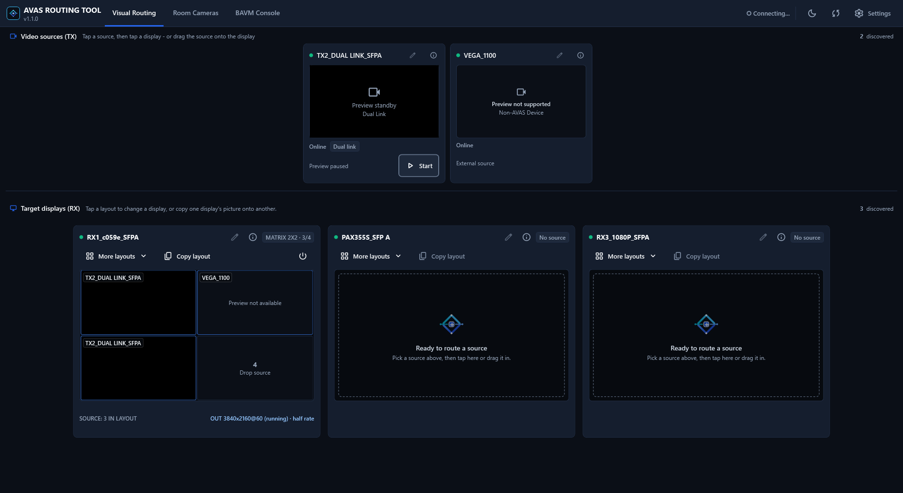
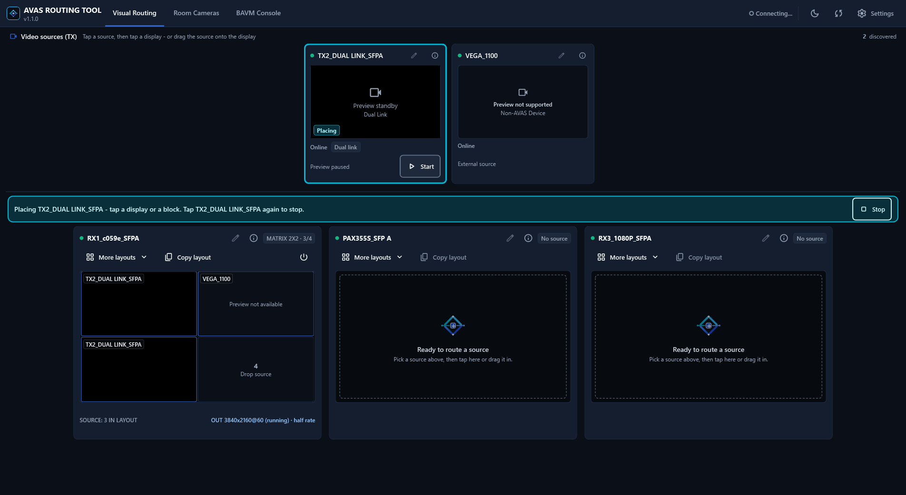
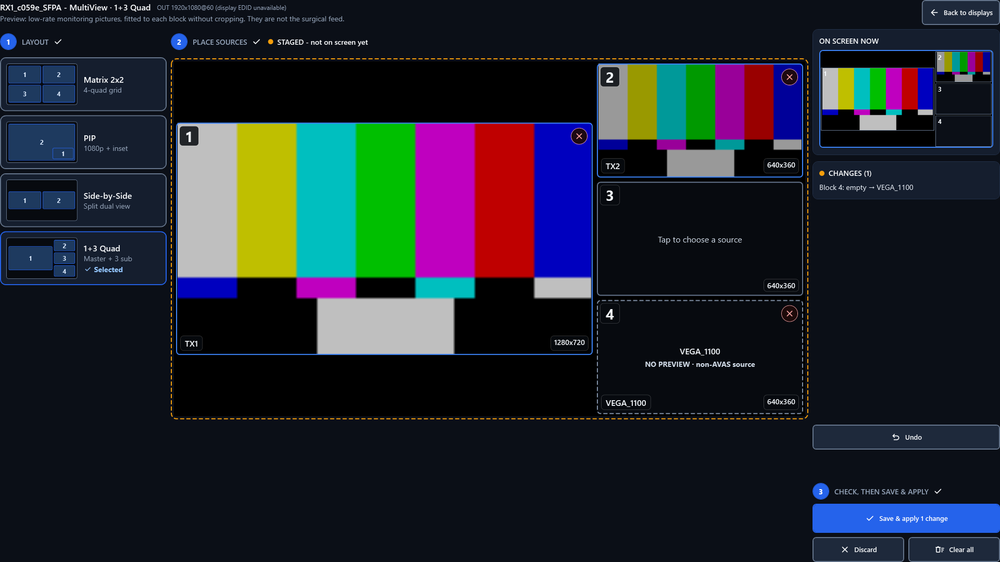
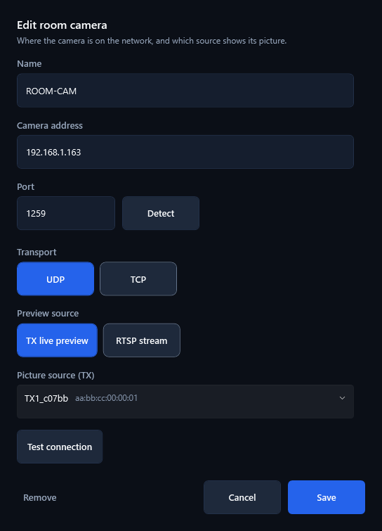
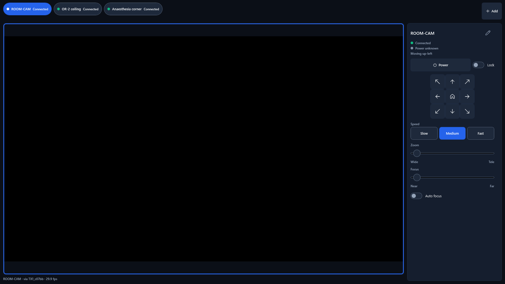
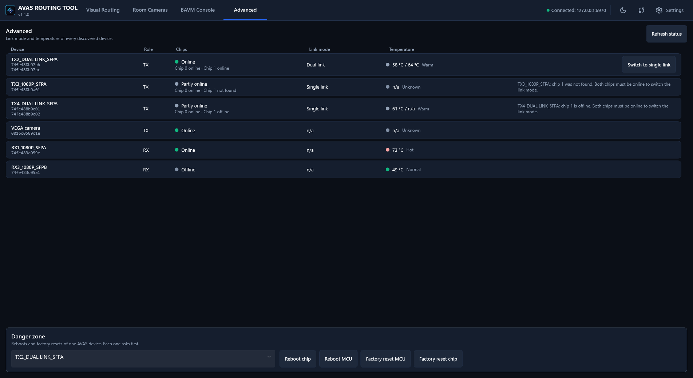

# AVAS Routing Tool: Quick Start Guide

**Version 1.1.0** · Advantech AVAS-2 Series (AVAS-212S / AVAS-223) · Windows 10/11 (64-bit)

The AVAS Routing Tool is a Windows application for controlling video in the operating room. You pick a video source (for example an endoscope or a room camera) and send it to a surgical display. You can also split one display into several pictures (MultiView), and control room cameras from the same window.

It works with Advantech AVAS transmitters (TX) and receivers (RX), which are built on the Semtech BlueRiver SDVoE platform.

---

## 1. Before you start

You need:

| Item | Details |
|---|---|
| Computer | Windows 10 or 11, 64-bit. A touch screen is supported. |
| Network | The computer must be on the same network as your AVAS devices and the BlueRiver Control Server. |
| BlueRiver Control Server | Running and reachable. By default the app expects it on the same computer (`localhost`). |
| Installed software | None. The package includes the .NET runtime, the video libraries and the Microsoft Edge WebView2 runtime used by the BAVM Console tab. |
| Disk space | About 1 GB once installed (the installer file is about 290 MB). |

---

## 2. Install and launch

1. Get **`AvasRoutingTool-Setup-1.1.0.exe`** from the location your Advantech contact gave you, and double-click it. You do not need administrator rights. The app installs for your Windows user only, by default under `%LOCALAPPDATA%\Programs\AVAS Routing Tool`.
2. Follow the wizard. Leave **Create a desktop shortcut** ticked, then choose **Install**.
3. On the last page, leave **Launch** ticked and choose **Finish**. The app opens full screen and starts looking for devices.

The installer also adds an entry to the Start Menu. Later, open the app from the desktop shortcut or the Start Menu.

> If Windows says it protected your PC (SmartScreen), choose **More info**, then **Run anyway**. The installer is not digitally signed, so Windows shows this message.

> If your firewall asks for permission the first time, allow the app. It needs network access to find devices and to show live previews.

**Update to a newer version:** run the new installer over the old one. Your saved settings are kept.

**Where settings are kept:** in the `appsettings.json` file in the install folder.

**Uninstall:** open Windows **Settings**, then **Apps** (Apps & Features), choose **AVAS Routing Tool** and **Uninstall**. The uninstaller asks whether to also delete your saved settings. Choose **No** to keep them for a later reinstall.

A portable zip also exists for IT use: unzip it and run `AvasRoutingTool.exe`. Keep the folder together, because the app needs the files next to `AvasRoutingTool.exe`, including the `libvlc` and `WebView2Runtime` folders.

---

## 3. First-time setup (about 2 minutes)

The defaults suit most installations. Check them once:

1. Open **Settings** (the **Settings** button in the top bar).
2. Confirm these values:

| Setting | Default | Change it when... |
|---|---|---|
| BAVM Web Management URL | `http://localhost:80` | The BlueRiver Control Server runs on another computer. Enter its address, for example `http://192.168.1.50:80`. |
| REST API Port | `8080` | Your Control Server uses a different port. |
| Telnet Control Port | `6970` | Your Control Server uses a different port. |
| Multicast Pool Start / End | `225.0.0.1` to `225.0.1.254` | Your network team has reserved a different multicast range. |

3. Press **Save & Apply**.

Two optional switches in Settings turn on extra tabs: **Show Logs tab (diagnostics)** and **Show Advanced tab (maintenance)**. Both are off by default.

---

## 4. The main window

The tabs along the top are:

| Tab | What it is for |
|---|---|
| **Visual Routing** | Send sources to displays. This is where you will spend most of your time. |
| **Room Cameras** | Move, zoom and focus room cameras, and see their picture. |
| **BAVM Console** | The BlueRiver AV Manager web page, built into the app. |
| **Logs** | Diagnostics. Shown only if enabled in Settings. |
| **Advanced** | Device status and maintenance actions. Shown only if enabled in Settings. |

---

## 5. Route a video source to a display

On **Visual Routing**, sources (TX) are at the top and target displays (RX) are below.

**Option A: tap and tap**
1. Tap a source card.
2. Tap the display you want it on.

**Option B: drag and drop**
1. Drag the source card onto the display card.

The display switches to the new source. Its card shows the live picture so you can see what is being sent.

**To turn a display off:** press **Turn Off** in the display card's action bar, or drag the **Off** tile onto the display.

On start-up, and when you press **Refresh** in the top bar, the app reads the real state from the devices. What you see always matches what the displays are showing.

> Sources that are not AVAS devices (for example third-party transceivers) can be routed like any other, but they show "Preview not available" instead of a live picture.

---

## 6. Show several pictures on one display (MultiView)

MultiView splits one display into blocks, each showing a different source. Open it from a display card by tapping a layout.

Available layouts:

| Layout | What it shows |
|---|---|
| **Matrix 2x2** | Four equal pictures. |
| **Picture-in-Picture** | One main picture with a small inset. |
| **Side by Side** | Two pictures, 50% each. |
| **1+3 Quad** | One large picture and three small ones. |

To build a layout in the Composer:

1. **Choose a layout** on the left. The blocks appear empty.
2. **Tap a source** in the strip, then tap the block it should fill. You can also tap an empty block first and then choose a source.
3. Use **Replace** or **Move** to rearrange. Use **Undo**, **Discard** or **Clear all** if you change your mind.
4. Press **Save & Apply**.

**Important:** the Composer shows **STAGED** changes. Nothing changes on the surgeon's screen until you press **Save & Apply**. The panel labelled **ON SCREEN** shows what is displayed right now.

The pictures in the Composer are low-rate monitoring previews. They are for planning only and are not the surgical feed.

The app reads each display's native resolution and sizes the layout to match. On very high-bandwidth layouts (for example 4K) it may reduce the frame rate of the pictures automatically.

---

## 7. Room cameras

Open the **Room Cameras** tab.

**Add a camera**
1. Press **Add a camera**.
2. Enter a **Name**, the **Camera address** and **Port**. Press **Detect** to let the app find the camera's port, or choose **UDP** or **TCP** and enter the port yourself.
3. Choose the **Preview source**:
   - **TX live preview**: use a picture source (TX) on your AVAS system.
   - **RTSP stream**: enter the camera's `rtsp://...` address.
4. Press **Test connection**, then **Save**.

**Control a camera**
- Use the pad to pan and tilt. Movement lasts only while you hold the button.
- **Speed**: Slow, Medium or Fast.
- **Zoom**: Wide to Tele. **Focus**: Near to Far, or switch on **Auto focus**.
- **Power** switches the camera on or off.
- **Lock** disables every motion control, so nothing moves by accident.
- If a message says **Stop not confirmed**, press **Stop** or switch the camera off.

Press **Start preview** on a camera card to see its picture.

---

## 8. Advanced tab (optional)

Enable it in Settings with **Show Advanced tab (maintenance)**. It lists every discovered device with its role, chips, link mode and temperature. Press **Refresh status** to update.

The **Danger zone** has **Reboot chip**, **Reboot MCU**, **Factory reset MCU** and **Factory reset chip** for one AVAS device. Each action asks you to confirm first. Use these only when advised by your support contact.

---

## 9. Troubleshooting

| Problem | What to check |
|---|---|
| No devices appear | Check that the BlueRiver Control Server is running, and that the **BAVM Web Management URL** and ports in Settings are right. Press **Refresh**. Make sure the computer is on the same network as the devices. |
| Devices appear but there is no live picture | Check that your network allows multicast (IGMP) and that your firewall allows the app. Non-AVAS devices never show a preview. |
| A route does not take effect | Press **Refresh** to re-read the real state from the devices, then try again. |
| The BAVM Console tab is blank | Open the URL from Settings in a normal browser to check the Control Server is reachable. |
| A room camera shows "Cannot reach..." | Check the address, port and transport (UDP or TCP) in the camera's settings. Press **Detect** or **Test connection**. |

**Logs for support:** turn on **Show Logs tab (diagnostics)** in Settings to see events live. The app also writes an `app.log` file, next to `AvasRoutingTool.exe` (or in `%LOCALAPPDATA%\AvasRoutingTool\Logs` if that folder is read-only). send it with your report.

---

## 10. Getting help

Please include with any report:
- The app version (shown in the top bar and in Settings): **1.1.0**
- What you were doing and what you expected
- The `app.log` file

For product information, contact your Advantech representative or open an issue in this repository.
