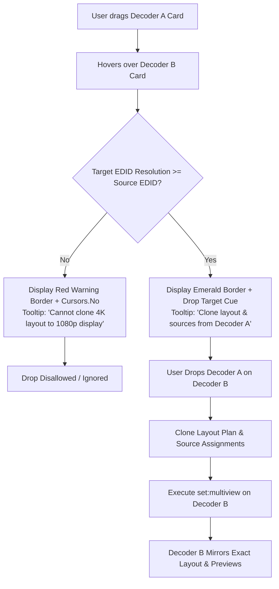

# Phase 2 MultiView UI/UX Enhancement Implementation Plan (v2)

> **For agentic workers:** REQUIRED SUB-SKILL: Use superpowers:subagent-driven-development (recommended) or superpowers:executing-plans to implement this plan task-by-task. Steps use checkbox (`- [ ]`) syntax for tracking.

**Goal:** Deliver a medical-grade, highly intuitive 3-step MultiView UI/UX workflow with parity to Phase 1 Single View, supporting empty layout staging, redundant encoder source assignment across multiple windows, click/drag source assignment, touch-friendly slot clearing, in-card layout selection, and decoder-to-decoder layout cloning with native resolution validation.

**Architecture:** Extend the MVVM layer (`DisplayCardViewModel`, `WindowSlotViewModel`, `MultiViewOrchestrator`) and WPF views (`DisplayCardView.xaml`, `FractionalLayoutPanel.cs`) to decouple layout staging from video execution, enable 1-to-many source-to-surface mapping for redundant windows, validate display EDID resolution compatibility during decoder-to-decoder drag operations, and provide instant visual feedback with zero network socket overhead.

**Tech Stack:** .NET 8.0 WPF (`net8.0-windows`), XAML Slate Dark Design System, Semtech BlueRiver REST API v3.9, RFC 4175 Zero-Leak Preview Mirroring.

---

## Confirmed User Decisions

1. **Encoder Redundancy**: An encoder can be assigned to multiple window slots on the same display simultaneously. The system shares the internal SDVoE `target_surface` (no duplicate subscription API error) and marks redundant windows with an accent `REDUNDANT` tag.
2. **Touch-Friendly Quick Picker**: Tapping/clicking an empty window block opens an in-place popover listing online encoders (with preview thumbnails) for 1-click assignment.
3. **Generous Clear Button (`✕`)**: Each assigned window slot features an enlarged, touch-friendly `✕` button (32×32px hit box, 44px touch margin) to unassign individual slots back to empty/black.
4. **In-Card Layout Selector**: Display cards include a `[ ⊞ Layout ▾ ]` header dropdown menu for direct 1-click layout switching.
5. **Decoder-to-Decoder Cloning**: Dragging one decoder card onto another clones the entire layout and source assignment, **strictly blocked if the target decoder's native resolution is lower than the source's native resolution**.

---

## Global Constraints

- **Single View Parity**: MultiView must offer the same drag-and-drop fluidity, high-contrast visual cues, and instant feedback as Phase 1 Single View.
- **Zero Socket Duplication**: Live previews on MultiView windows must mirror existing `WriteableBitmap` references from `SourceCardViewModel`; no new UDP ports or IGMP joins.
- **Hardware Conformance**: Pinned to SDVoE API Reference 3.9 §5.2. `set:multiview` subscriptions must never contain duplicate `(source_device, stream_index)` or duplicate `subscription_index`. Redundant windows share `target_surface`.
- **Resolution Safety Gate**: A layout cannot be cloned to a display whose native EDID resolution (width × height) is lower than the source display's native resolution.
- **STA Thread Safety**: Every XAML modification must be verified via `ViewSmokeTests.RunSta` to prevent runtime binding exceptions.

---

## Workflows & Visual Flows

### 1. 3-Step MultiView Workflow

```mermaid
flowchart LR
    subgraph Step1["Step 1: Layout Selection"]
        L1[Drop Layout Tile OR<br/>Select Card Header Menu] --> L2[Display Card Enters Staged Mode<br/>Empty Windows Rendered]
        L2 --> L3[Canvas Resolution from EDID<br/>No Hardware Routing Yet]
    end

    subgraph Step2["Step 2: Source Assignment & Redundancy"]
        S1[Drag Encoder to Window OR<br/>Click Empty Slot Picker] --> S2[Assign Source to Slot]
        S2 --> S3{Same Source Already Used?}
        S3 -- Yes --> S4[Allow Redundant Assignment<br/>Share Target Surface & Scaler]
        S3 -- No --> S5[Allocate Target Surface & Scaler]
        S4 --> S6[Apply / Update MultiView REST]
        S5 --> S6
    end

    subgraph Step3["Step 3: Preview Fitting & Management"]
        P1[Mirror Source Bitmap to Slot Image] --> P2[Uniform Letterbox Fit in 16:9]
        P2 --> P3[Overlay Source Pill, FPS & Badges]
        P3 --> P4[Touch-Friendly Clear ✕ (32x32px)]
    end

    Step1 --> Step2 --> Step3
```

### 2. Decoder-to-Decoder Layout Cloning Flow



---

## Detailed Component Changes

### Component 1: MultiView Orchestration & Cloning Engine (`Sdvoe/MultiView`)

#### [MODIFY] `MultiViewOrchestrator.cs`
- **Redundancy Support**:
  - Allow `session.Assignments[slotIndex] = tx` without removing previous slots with the same `tx`.
  - In `AssignAsync`, when building `subscriptions` for `set:multiview`, group slots by source MAC and assign the same `target_surface` to all slots displaying the same source.
- **Individual Slot Unassignment (`UnassignSlotAsync`)**:
  - Removes assignment for `slotIndex`.
  - If other slots remain assigned: re-applies `set:multiview` with remaining subscriptions (cleared window renders black or default background).
  - If all slots become empty: resets decoder back to genlocked Single View or idle state.
- **Decoder Cloning (`CloneSessionAsync`)**:
  - `CanClone(AvasDevice sourceRx, AvasDevice targetRx, out string? reason)`:
    - Verifies both are online receivers.
    - Checks `targetCanvas.PixelCount >= sourceCanvas.PixelCount`. If target is lower, returns `false` with explicit explanation (e.g. `Target monitor (1920×1080) has lower resolution than source (3840×2160)`).
  - `CloneSessionAsync(AvasDevice sourceRx, AvasDevice targetRx)`:
    - Copies source layout ID and slot assignments.
    - Resolves target canvas from target EDID.
    - Re-applies layout and subscriptions to target hardware.

#### [MODIFY] `MultiViewRequests.cs`
- In `SetMultiView`, deduplicate `subscriptions` array so that identical `(source_device, stream_index)` entries are unified under a single target surface.

---

### Component 2: ViewModels & Commands (`ViewModels`)

#### [MODIFY] `WindowSlotViewModel.cs`
- Add `IsRedundant`: true if another slot in the same display has the same source assigned.
- Add `ClearSlotCommand` (`ICommand`): triggers unassignment of this specific slot.
- Enlarge touch target dimensions and exposure.

#### [MODIFY] `DisplayCardViewModel.cs`
- Support `DisplayCardViewModel` as a drag source and drop target for decoder cloning:
  - Implement `CanAcceptDecoderDrop(DisplayCardViewModel sourceCard)` checking resolution compatibility.
  - Implement `CloneFromAsync(DisplayCardViewModel sourceCard)`.
- Add `IsStaged`: true when `IsMultiView` is active but 0 slots are assigned.
- Add `AvailableEncoders`: observable list of online transmitters for the click-to-assign picker.
- Add `CardLayoutOptions`: collection of presets for the `[ ⊞ Layout ▾ ]` in-card dropdown.
- Update `ModeBadge` to indicate `(STAGED)`, `(N/M)`, or `(FULL)`.

#### [MODIFY] `MainViewModel.cs`
- Handle decoder drag-drop routing in `RouteVideoAsync` when payload contains `DisplayCardViewModel`.
- Expose layout options and encoder lists to child display card view models.

---

### Component 3: WPF Views & Touch Styling (`Views` & `Controls`)

#### [MODIFY] `DisplayCardView.xaml` & `DisplayCardView.xaml.cs`
- **Decoder Drag-and-Drop**:
  - Handle `MouseMove` to initiate `DoDragDrop` with `DisplayCardViewModel` payload when dragged from header.
  - Handle `Card_DragOver` to inspect if dragged payload is `DisplayCardViewModel`:
    - If valid clone target -> highlight emerald border (`#10b981`), `DragDropEffects.Copy`.
    - If lower resolution -> highlight warning red border (`#ef4444`), show warning tooltip, `DragDropEffects.None`.
- **In-Card Layout Dropdown**:
  - Add sleek header button `[ ⊞ Layout ▾ ]` opening a compact ContextMenu/Popup with thumbnail layout icons.
- **Enlarged Touch-Friendly (✕) Clear Button**:
  - Size: `Width="32" Height="32"` with circular hover state `#33EF4444`, accessible border, and clear vector `✕` icon.
  - Position: Top-right corner of the window block with `Margin="4"`.
  - Touch margin: Hit-test invisible padding extending to 44×44px.
- **Quick-Assign Popover**:
  - When an empty slot is clicked, show a lightweight `Popup` anchored to the slot displaying online Encoders with live preview thumbnails.
  - 1-click on an encoder immediately assigns it to that slot.
- **Redundancy Tag**:
  - When `IsRedundant` is true, display a distinctive `REDUNDANT` pill badge next to the source name.

---

## Tasks Breakdown

### Task 1: Redundancy & Surface Sharing in MultiView Core (TDD)
- [ ] Add unit tests in `MultiViewOrchestratorRedundancyTests.cs`:
  - Assign same TX to Slot 0 and Slot 1 -> both slots retained.
  - Both slots share the same `target_surface`.
  - `subscriptions` in `SetMultiView` contains exactly one entry for that TX.
- [ ] Update `MultiViewOrchestrator.cs` and `MultiViewRequests.cs`.
- [ ] Verify non-live test suite passes.

### Task 2: Individual Slot Clear / Unassignment (TDD)
- [ ] Add unit tests in `MultiViewOrchestratorSlotClearTests.cs`:
  - Unassigning 1 slot leaves other slots playing.
  - Unassigning all slots returns decoder to genlock/unrouted.
- [ ] Implement `UnassignSlotAsync` in `MultiViewOrchestrator.cs`.
- [ ] Implement `ClearSlotCommand` on `WindowSlotViewModel.cs`.
- [ ] Verify non-live test suite passes.

### Task 3: Decoder-to-Decoder Layout Cloning & Resolution Gate (TDD)
- [ ] Add unit tests in `DecoderCloningTests.cs`:
  - Target with equal or higher resolution successfully clones layout and slots.
  - Target with lower native resolution is blocked with error message.
  - Cloning Single View decoder routes single source.
- [ ] Implement `CanClone` and `CloneSessionAsync` in `MultiViewOrchestrator.cs`.
- [ ] Implement `CloneFromAsync` in `DisplayCardViewModel.cs` and wire in `MainViewModel.cs`.
- [ ] Verify non-live test suite passes.

### Task 4: ViewModels Polish & Quick Encoder Picker (TDD)
- [ ] Add unit tests in `DisplayCardViewModelMultiViewEnhancementTests.cs`:
  - `IsStaged` state when layout chosen with 0 sources.
  - `IsRedundant` property on slots.
  - `AssignSlotCommand` logic.
- [ ] Implement properties in `DisplayCardViewModel.cs` and `WindowSlotViewModel.cs`.
- [ ] Verify non-live test suite passes.

### Task 5: WPF UI Implementation & STA Smoke Tests (`Views`)
- [ ] Update `DisplayCardView.xaml`:
  - Add enlarged 32×32px `✕` clear button with touch padding.
  - Add `[ ⊞ Layout ▾ ]` in-card layout selector popup.
  - Add click-to-assign popover on empty slots.
  - Add Decoder drag initiation and drop handling with resolution check visual cues.
  - Add `REDUNDANT` tag on duplicated window slots.
- [ ] Add STA smoke tests in `ViewSmokeTests.cs` covering:
  - Staged empty layout rendering.
  - Redundant slot view rendering.
  - 32×32px clear button command binding.
  - Decoder-to-decoder drag/drop visual states.
- [ ] Run `dotnet test` to ensure 100% green tests.

### Task 6: Lab Verification, Packaging & Memory Update
- [ ] Verify on lab hardware (RX1, TX2, VEGA_1100).
- [ ] Build and publish standalone executable (`publish/AvasRoutingTool`).
- [ ] Update `memory/active_context.md` and `memory/progress.md`.
- [ ] Commit changes atomically.
