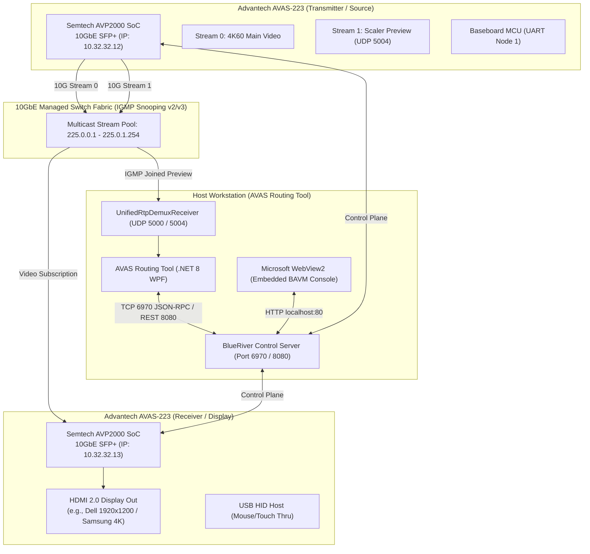
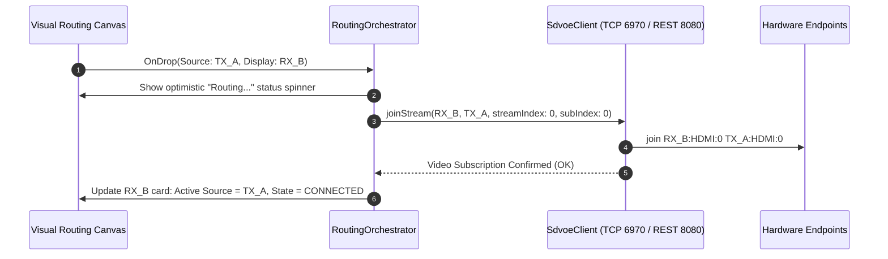

# AVAS Routing Tool: System Design Specification

**Document ID**: `SPEC-AVAS-ROUTING-TOOL-001`  
**Date**: 2026-10-25  
**Status**: Approved / Draft for Implementation  
**Target Platform**: Windows 10/11 x64 (.NET 8 WPF `net8.0-windows`)  
**Target Hardware**: Advantech AVAS-223 SDVoE Transceiver (Semtech AVP2000 & Baseboard MCU)  
**Parent Reference**: BlueRiver AV Manager 2.1.0 (`BAVM`), CYP SingleLink REA (`SDVoE_Tester`), `AVAS-BRV-wrapper-win`  

---

## 1. Executive Summary & Objective

The primary objective of **AVAS Routing Tool** is to provide an intuitive, high-performance visual routing interface for medical and industrial operating rooms while **inheriting 100% of BlueRiver AV Manager (BAVM) functions without altering them**.

### Core Value Propositions:
1. **First-Class Visual Routing Canvas**:
   - Replaces the tedious, table-based or dropdown routing with an interactive, 3-tier visual canvas inspired by SigmaXG (`Sources` on top, `Displays` in the middle, `Layouts` on the bottom).
   - Allows operators to visually drag-and-drop a video source (TX) directly onto a display (RX) or click to route.
2. **Real-Time Live Video Previews**:
   - All discovered Encoders (TX) render live low-latency preview thumbnails directly on their cards using the hardware-accelerated Stream 1 Scaler RTP pipeline on UDP port 5004 / 5000.
3. **100% BAVM Functional Preservation**:
   - The entire official BAVM web management console is embedded via an isolated Microsoft WebView2 tab (`[ 🎛 BAVM Console ]`). All advanced administrative capabilities—device configuration, audio/USB matrices, presets, video walls, EDID management, security, and firmware updates—remain completely accessible and unmodified.
   - BAVM URL is fully user-configurable (defaults to `http://localhost:80`) and persisted.
   - SDVoE Control Server IP is synchronized to match the BAVM host IP, with configurable Telnet/REST ports.
4. **Single View Video Routing (Phase 1)**:
   - Dropping a Source TX onto a Display RX configures **Video Routing only**: `join <rx>:HDMI:0 <tx>:HDMI:0` (Genlocked or Fast-switched).
   - Audio and USB-KVM routing are intentionally handled by the original BAVM console in Phase 1, keeping the visual router lightweight and ultra-focused.
5. **Device Naming Standard**:
   - Displays and Sources strictly display their configured **Device Name** as set in BAVM (no raw EDID sink names).
6. **MultiView Staging (Phase 2)**:
   - MultiView layout templates (`matrix-2x2`, `pip`, `side-by-side`, `one-plus-three`, `one-plus-three-right`) are visually present in the bottom row ready for Phase 2 window-level assignment.
7. **Organized, Consistent Project Memory**:
   - All architectural decisions, active session context, system patterns, and progress state are rigorously maintained in a dedicated `memory/` sub-directory and versioned alongside the code.

---

## 2. Hardware & Network Topology



---

## 3. UI/UX Architecture: 3-Tier Canvas & Dual-Mode Shell

### 3.1 Top Header & Mode Navigation
* **Application Title & Version**: `AVAS ROUTING TOOL v1.0.0 | SDVoE Visual Router`.
* **Primary Navigation Tabs**:
  * `[ 🔀 Visual Routing ]`: The primary interactive canvas.
  * `[ 🎛 BAVM Console ]`: The embedded full-screen BAVM web management console.
  * `[ 📊 Diagnostics & Health ]`: AVAS-223 hardware thermals, link modes (Single/Dual), and packet statistics.
* **Global Controls**:
  * Server Connection Indicator (`● Connected: 127.0.0.1:6970`).
  * `[ ⚙ Settings ]` dialog launcher (Server IP, Telnet/REST ports, Multicast pool, Network Interface selection).

### 3.2 Tier 1: Sources (Encoders / TX) Row
* **Location**: Top row of the Visual Routing canvas.
* **Component**: Horizontally scrollable reel of dynamically populated Source cards (`ObservableCollection`).
* **Dynamic Device Lifecycle**:
  * Cards are dynamically created based on discovered devices from the Control Server.
  * When `status.active == true`: Shows full live video preview, green "Online" dot, and live rolling FPS pill. Card is draggable.
  * When `status.active == false`: Shows muted card with "Offline" badge, video preview paused/standby placeholder, and drag disabled.
* **Card Details**:
  * Header: Configured **Device Name** as set in BAVM (e.g. `Bron 1`, `Endo Cam 1`) and online/offline pill.
  * Center: **Live Video Preview Surface** (16:9 aspect ratio, updating at >= 1 FPS via direct `WriteableBitmap` rendering when online).
  * Sub-text: IP Address (`10.32.32.12`), MAC address, detected resolution (e.g., `1080p60`), and live FPS indicator pill.
* **Interaction**: Draggable card (when online) initiating a drag-and-drop routing gesture.

### 3.3 Tier 2: Displays (Decoders / RX) Row
* **Location**: Middle row of the Visual Routing canvas.
* **Component**: Dynamically populated grid of Display cards representing physical surgical/diagnostic monitors (`ObservableCollection`).
* **Dynamic Device Lifecycle**:
  * Cards dynamically reflect the exact set of decoders reported by the Control Server.
  * When `status.active == true`: Active drop target with real-time routed source name and streaming status.
  * When `status.active == false`: Muted card displaying "Offline", drop disabled.
* **Card Details**:
  * Header: Configured **Device Name** as set in BAVM (e.g. `Samsung 1`, `Monitor 2`) and online/offline pill.
  * Center: **Viewport Surface**. In Single View mode, displays:
    * When routed: The friendly device name of the active Source TX, current streaming state (`STREAMING`), and resolution.
    * When unrouted (online): Clean empty state (`[ Drop Source Here to Route ]`).
    * When offline: Standby state (`[ Device Offline ]`).
  * Sub-text: Receiver IP, MAC, Output Resolution, Hot Plug Detect (HPD) status.
  * Disconnect Action: Quick `[ ✕ Unroute ]` button or drop target for `Off` layout.
* **Interaction**: Drop target (when online) accepting Source cards or Layout cards.

### 3.4 Tier 3: Layouts Row
* **Location**: Bottom row of the Visual Routing canvas.
* **Layout Presets**:
  * `Off`: Clears subscriptions on dropped display.
  * `Single View` (Phase 1 Active): Full-screen single viewport.
  * `Matrix 2x2` (Phase 2 Staged): 4 equal quadrants.
  * `Picture-in-Picture` (Phase 2 Staged): Main background + inset top-left/bottom-right.
  * `Side-by-Side` (Phase 2 Staged): Two equal vertical halves.
  * `1+3 Quad View` (Phase 2 Staged): 1 large left window + 3 stacked right windows.
* **Interaction**: Drag layout card onto a Display card to apply layout mode.

---

## 4. Control Plane & Media Plane Implementation

### 4.1 Single View Video Routing Flow (Phase 1)
When a user drags Source $TX_A$ and drops it onto Display $RX_B$:



*(Note: Audio and USB-KVM routing are maintained within the embedded BAVM console during Phase 1).*

### 4.2 Live Video Preview Acquisition Pipeline
* **Source Discovery**: Query Control Server (`get:devices`). For every device where `identity.is_transmitter == true`, register in the preview manager.
* **Multicast IP Allocation**: Assign dedicated Class D IP from `225.0.0.1` to `225.0.1.254`.
* **Hardware Trigger**: Command Semtech Stream 1 Scaler (`HDMI:1`):
  `set <mac> stream HDMI 1 enable true address <MCAST_IP> auto_stop true remove_audio true`
* **Multicast Ingestion (`UnifiedRtpDemuxReceiver`)**:
  * Binds to UDP port `5004` (and `5000` fallback) with `SocketOptionName.ReuseAddress = true` and 8MB socket buffer.
  * Emits IGMP membership report for `<MCAST_IP>` on selected local adapter NIC.
  * Direct source-IP filtering: drops packets from unregistered IPs at entry.
  * Reassembles RFC 4175 scanlines (`line_number`, `offset`, `length`).
  * Rasterizes YUV422 macro-pixels $[Y_0, U, Y_1, V]$ using fixed-point BT.601 math into `WriteableBitmap.BackBuffer`.
  * Triggers frame presentation via `Dispatcher` without GDI+ memory allocations.

### 4.3 Deterministic Teardown Protocol
When unrouting a stream or closing the application:
1. **Control Plane Nullification**: Set address to `0.0.0.0` with `enable false`:
   `set <mac> stream HDMI 1 enable false address 0.0.0.0`
2. **Media Plane Disposal**: Drop host IGMP multicast membership (`DropMulticastGroup`) and flush packet reassembly buffers.

---

## 5. Project Memory Architecture (`memory/`)

In adherence to the core project requirement, an organized, consistent memory structure is initialized under `memory/`:

```
memory/
├── README.md              # Rules of engagement, update workflows, and index
├── active_context.md      # Current task focus, next steps, active blockers
├── product_context.md     # High-level domain concepts, goals, and problem statement
├── system_patterns.md     # Architecture patterns, conventions, standards
├── progress.md            # What works, what's in progress, roadmap milestones
├── GLOSSARY.md            # Canonical domain vocabulary
└── decisions/             # Architecture Decision Records (ADRs)
    └── 2026-10-25-init-memory-and-hybrid-shell.md  # ADR 001
```

### Memory Maintenance Rules:
1. **Read on Startup**: Agents read `memory/active_context.md` at session start.
2. **Write on Completion**: Agents update `active_context.md` and `progress.md` before concluding tasks.
3. **Atomic Git Commits**: Documentation updates in `memory/` are committed alongside code changes.

---

## 6. Phase Phasing & Delivery Roadmap

* **Phase 1: Single View Foundation**:
  * Complete WPF App shell with Dual-Mode navigation (`Visual Routing` + `BAVM Console`).
  * Live preview carousel for TX Encoders on UDP 5004.
  * Display RX cards with drag-and-drop Single View video routing.
  * Automated 3-in-1 routing: Video, HDMI Audio, and USB Mouse/Touch Thru.
  * Disconnect / unroute functionality.
  * Full BAVM web console embedding in WebView2.
* **Phase 2: MultiView Expansion**:
  * MultiView layout templates activation (`matrix-2x2`, `pip`, `side-by-side`, `1+3`).
  * Multi-viewport drag-and-drop target partitioning.
  * Advanced viewport swapping and source replacement.
