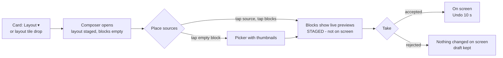
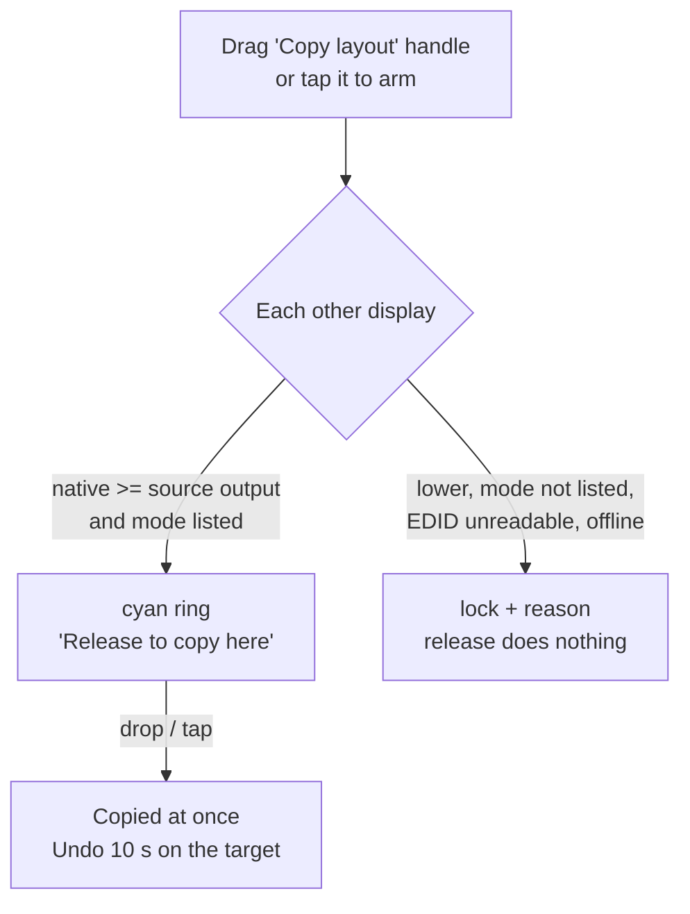

# MultiView Composer - UX Design Spec (proposal for approval)

**Status:** Implemented on branch `feat/multiview-composer` and verified by tests and reviews; **hardware lab validation NOT run** (see "Validation status" in section 2). Proposal dated 2026-10-25. Builds on, and amends, Antigravity's draft `docs/superpowers/plans/2026-10-25-phase2-multiview-ui-ux-enhancement.md` (see "Relation to the Antigravity draft").
**Plan:** `docs/superpowers/plans/2026-10-25-multiview-composer.md`
**Visual mockup:** interactive HTML prototype published with this proposal (link in the hand-off message).

## 1. Requirement (from the product owner, verbatim intent)

MultiView must have the same consistency of functionality as Phase 1 Single View, in three steps:
1. Set the MultiView layout of the screen (no video routed yet).
2. Choose which encoder goes in which block; the same encoder may be used in several blocks (redundancy).
3. Every time an encoder is set into a block, its live preview follows and fits that specific block.

## 2. Confirmed decisions (2026-10-25)

| Question | Decision |
|---|---|
| When does the surgeon's screen change? | **Stage, then Take.** Steps 1-3 build a staged picture; the real display changes only when the operator presses **Take**. |
| Who operates it, how? | **Circulating nurse / OR staff on a touchscreen, possibly gloved, under time pressure.** Touch first; mouse and drag stay as shortcuts. |
| Same encoder twice in blocks of different sizes? | **Only equal-size blocks.** A different-size block is shown as unavailable for that encoder, with a one-line reason. |

Hardware basis: a multiview window is a 1:1 view onto an area of the decoder frame buffer (windows do not scale), and the API counts windows (32) and distinct sources/surfaces (32) separately (PDS-062489 §5.1/5.1.1). So equal-size blocks showing the same encoder share **one surface and one subscription**; different sizes would need two scaled streams from one encoder, which an encoder does not have. **Confirmed on the lab spike (plan Task 1, user-confirmed pictures):** TX2 in blocks 1 and 3 through one surface and one subscription, VEGA in block 2, block 4 black as designed. The spike also showed that a window without `target_surface` is black on the server but reads back as VIDEO / surface 255 (restore treats it as empty), and that a decoder keeps its **own copy** of a layout, so overwriting a layout on the server did not change decoders already running it.

### Validation status (2026-10-27)

**Hardware lab validation of the finished Composer was NOT run.** The product owner decided to skip plan Task 12 steps 1-2. What exists instead: the unit, integration and view (STA smoke) tests - 701 tests under the filter `FullyQualifiedName!~LiveControlServerTests&FullyQualifiedName!~LiveFunctionTests`, the `Live*` hardware test classes were never run for this work - and four reviews (per-task spec and quality reviews, a final engine review and a final views review, then a scoped re-review). They cover behaviour against the mocks and the rendered views; they do not prove what a decoder does.

What the lab run would have covered (plan Task 12 steps 1-2), none of it executed:
- **RX1, Matrix 2x2:** TX2 in blocks 1 and 3 and VEGA in block 2, **Take**, the operator confirms the picture; **Undo**.
- **RX1, layout change to PiP** with TX2 in the main block: TX2 shown as unavailable for the inset with the reason text from section 6.
- **RX1, 4K 1+3** with Take.
- **Disconnect a source while staged:** Take is blocked.
- **Copy RX1 (4K Matrix) onto PAX355S (4K):** PAX355S shows the same picture; **Undo** puts PAX355S back to its previous state; **copy a Single View RX1** onto PAX355S.
- Restore the lab afterwards.

The lower-resolution copy block (target native size below the source's output) cannot be shown on hardware with today's two 4K decoders. It is covered by the `DisplayCopyPlanner` tests only, and would stay so even after a lab run.

Assumptions that are **unverified on hardware**:
- **R13:** a Single View source's output format is taken as the source display's EDID preferred mode (1920x1080@60 if unreadable). A genlocked decoder really outputs the encoder's timing, so the guard could block a copy it should allow, or rarely allow one it should block.
- **R16:** a copied *external* (read-only, made elsewhere) layout keeps every window's offsets and every subscription's stream index as read back. If the read-back omits the stream index, the copy would subscribe stream 0 instead of stream 1.
- **EDID modes** are read only from detailed timing descriptors and the base CTA video data block. HDMI_VIC (4K24/25/30 through the vendor block) and YCbCr 4:2:0-only 4K modes are not seen, so a target that lists 4K60 only as 4:2:0 is conservatively **blocked** for copy (never a false allow).
- Real mouse and touch **drag**, and the drag **ghost at a display scale other than 100 %** (tests use a fake drag starter), held keys, a screen reader, and Alt-Tab behaviour of the keyboard focus guard.

Product decisions made during the build and flagged to the product owner:
- **R12:** a card running an *external* layout routes Single View on drop or tap, with no drop choice (Phase 1 behaviour), so an external MultiView can be replaced without the two-choice prompt of section 5.1.
- **R20/R21:** while composing, the Sources row becomes a **compact palette strip** (name, status, link mode, small thumbnail) so the Composer fits 1280x860 and the 1024x720 minimum with Take visible; the full-size Sources row of the mock-up in 5.2 is not kept.
- **First Take on an empty display offers no Undo** (the engine has no previous picture to restore).

## 3. Who and where

A nurse a step away from a 24-27" touch panel on the OR console, gloves on, surgeon waiting. Success = the intended sources are on the intended blocks of the intended screen, first time, and nothing changed on the surgeon's screen until they meant it to. Mode: **Operate** - precision and restraint over expression; reuse the existing dark slate theme.

## 4. The model in one sentence

**Tap (or drag) a source, tap a destination** - everywhere. On a display card that destination routes immediately (Single View, as today); inside the MultiView Composer it fills a block of a *staged* picture that goes on screen with **Take**.

## 5. Surfaces

### 5.1 Overview (existing screen, small changes)
- **Tap-to-arm everywhere.** Tapping a source card arms it (cyan ring + banner "Placing TX2 - tap a display or a block. Tap TX2 again to stop."). Tapping a display card then routes it in Single View immediately (Phase 1 behaviour, now without drag). Drag still works. Auto-disarm after 15 s idle or after one Single View route.
- **Layout ▾ on every display card** (adopted from Antigravity v2, confirmed 2026-10-26; as built it sits on a button row **under the card name**, next to **Copy layout**, not on the name line): a >= 56 px button opens a popup of schematic tiles (Single View, Matrix 2x2, PIP, Side-by-Side, 1+3, Off). Picking a MultiView preset opens the Composer with that layout **already staged** (Step 1 done); Single View / Off behave as the bottom-bar tiles do today. Dragging a layout tile from the bottom bar onto a card does the same.
- **Display card in MultiView** keeps showing the *live* composite (today's behaviour). Tapping the composite (the card's mini picture; there is no separate Edit MultiView button), the **Layout** menu, or the draft chip's **Resume** opens the Composer with what is on screen.
- **Card badge shows fill** (adopted): "MATRIX 2x2 · 3/4" - layout and how many blocks carry a source, on screen.
- **Dropping (or tapping) a source on a MultiView card** no longer silently replaces the multiview. An inline two-choice prompt on the card: **Full screen (Single View)** - goes live now; **Into a block...** - opens the Composer with the source armed. One tap either way; the prompt closes after 10 s. Exception as built (ruling R12): a card running an **external, read-only** layout routes Single View straight away, without the prompt.
- **Draft chip** on a card with unsent Composer changes: "DRAFT · Resume" (>= 56 px high), the third control of the card's **header button row** beside Layout and Copy layout (ruling R24), never over the picture or the error banner, so a draft never hides the hardware's reason.

### 5.2 MultiView Composer (new; replaces the Displays row while open; the Sources row stays visible above as the palette, shown as a **compact strip** while composing - rulings R20/R21; the sketch below shows the palette at full size)

```
+------------------------------------------------------------------------------------------+
| SOURCES (palette, unchanged cards; armed / "in 2 blocks" badges)                          |
+---------------+----------------------------------------------------------+---------------+
| 1 LAYOUT      |  RX1_c059e_SFPA - MultiView        OUT 3840x2160@60      | ON SCREEN NOW |
|  [Matrix 2x2] |  +---------------------------+---------------------------+ | [live mini   ]|
|  [PIP       ] |  | 1  TX2  (staged, live     | 2  + Tap to place TX2     | | [composite   ]|
|  [Side/Side ] |  |     preview fitted)       |                           | |  1080p Matrix |
|  [1 + 3     ] |  +---------------------------+---------------------------+ +---------------+
|               |  | 3  TX2  "Same as 1"       | 4  VEGA  NO PREVIEW       | | CHANGES (3)   |
| 2 PLACE       |  |                           |    (non-AVAS)             | | 1: - -> TX2   |
|  tap a source,|  +---------------------------+---------------------------+ | 3: - -> TX2   |
|  tap blocks   |   STAGED - not on screen yet   (amber dashed frame)      | | 4: - -> VEGA  |
| 3 CHECK, TAKE |                                                          | [ TAKE 3 TO   ]|
|               |                                                          | [  SCREEN     ]|
|               |                                                          | [Discard][Close]|
+---------------+----------------------------------------------------------+---------------+
```

- **Left rail - Step 1 Layout:** the four presets as large tiles (>= 200x96 px) drawn as schematics of the real block geometry for this display's output (from EDID), not text only. The selected tile is marked by border, check icon and "Selected" text. Changing the layout re-maps placed sources by block order (1->1, 2->2...); sources that no longer fit are listed as **Unplaced** chips the operator can tap to re-place. Nothing reaches the screen.
- **Centre - the staged canvas (Steps 2 and 3):** the display at its real output aspect, as large as the space allows (a Matrix block is ~620x350 px on a 1920x1080 panel, versus ~150-300 px inside a card today). Steps are numbered zones of one screen, not wizard pages: an expert can go straight to placing; the step markers on the rail tick as they complete (layout chosen, >= 1 block placed, Take available).
- **Right rail - ON SCREEN NOW + Take:** a small live composite of what the surgeon sees right now (mirrored previews), the output format, the list of changes, and the actions. Take, the blocked reason and Undo are pinned outside the rail's scroll area so Take stays visible at 1280x860 and at the 1024x720 minimum; below 1200 px the rails narrow (240/264 px). Measured Matrix block sizes with the compact palette: ~612x341 px in a 1920x1014 content area, ~284x156 at 1264x755 and ~204x111 at the 1008x615 minimum.

### Flow at a glance



## 6. Step 2 - placing sources (touch-first)

Three equivalent gestures, one result:
1. **Source first (primary):** tap a source in the palette -> armed. Every block shows either **+ Place TX2** (available) or a dimmed lock with the reason (unavailable). Tap any number of blocks to place it; it **stays armed**, so placing the same encoder in blocks 1 and 3 is two taps (redundancy is the natural path, not a special mode). Tap the source again, **Done**, or any empty area to disarm.
2. **Block first:** tap an empty block -> a picker anchored to the block: online sources as tiles with their live thumbnail (>= 160x90) and name; unavailable ones disabled with the reason. Tap one -> placed, picker closes.
3. **Drag (mouse / technician, Phase 1 parity):** drag a source card onto a block; drag a block onto a block to **move** (empty target) or **swap** (occupied). 8 px movement threshold before a drag starts.

Placed block (confirmed 2026-10-26):
- **Corner ✕** always visible on every placed block - one tap clears it (visual 32 px, hit area >= 48 px through invisible padding, adopted from Antigravity v2's technique). Safe as a single tap because nothing reaches the screen until Take.
- **Tap the block** -> an inline action strip inside the block (no hover anywhere): **Replace** (opens the picker) and **Move** (then tap a destination block; occupied = swap).
- **Clear all** sits in the right rail.

### Availability rules (always shown as text, never only as colour)
| Situation | Block shows | Reason text |
|---|---|---|
| Encoder offline | lock | "TX2 is offline" |
| Encoder already in a different-size block of this layout | lock | "TX2 is in block 1 at 1920x1080 - this block is 1280x720. One encoder has one size per layout." |
| Encoder used at another size on another display's layout (live or draft) | lock | "TX2 runs at 1920x1080 on RX2 - this block is 960x540." |
| Equal-size duplicate | available | placed block gets a "Same as 1" chip |

## 7. Step 3 - live preview follows and fits the block

- A block shows its encoder's live preview the moment it is placed (staged), mirrored from the source card's existing bitmap - no new streams or sockets.
- The preview is fitted **uniformly** inside the block: blocks are 16:9 and previews are 16:9, so it fills; a non-16:9 source is letterboxed, never stretched or cropped.
- Overlay (legible from a step back): block number top-left (28 px), source name pill bottom-left (16 px), status chips: **NO PREVIEW** (non-AVAS, with the source name centred), **NO SIGNAL** (0 fps for > 2 s, last frame dimmed - **not built**: the block view-model carries no signal/fps state; follow-up), **OFFLINE**, **Same as 1**.
- These are monitoring previews (low rate), not the surgical feed; a "Preview" caption on the canvas header says so once.
- When the layout runs sources at half frame rate (bandwidth > 9 Gbps), the header says "Sources at 30 fps on this layout".

## 8. Take, Undo, Discard, drafts

- **Take** (primary, >= 72 px high, full rail width): label states the effect, e.g. "TAKE 3 CHANGES TO SCREEN". Disabled with the reason underneath when there is nothing to take or an issue blocks it (offline encoder, conflict). One tap, no confirmation dialog - Take *is* the confirmation.
- **While taking:** button shows progress ("Sending to RX1..."), the Composer is locked, a second tap does nothing.
- **Success:** the staged frame turns into the live frame (one 400 ms transition, skipped when Windows animations are off), ON SCREEN NOW updates, a toast "On screen" with **Undo** for 10 s. Undo = take the previous on-screen state again. The first Take on a display that showed nothing has no previous picture, so it offers no Undo (flagged to the product owner).
- **Failure:** red banner with the hardware's reason and "Nothing changed on screen"; the draft stays intact.
- **Discard** returns the draft to what is on screen. **Close** keeps the draft (no blocking dialog under time pressure); the card shows the DRAFT chip.
- **Screen changed elsewhere** (state re-read from hardware, e.g. someone used the BAVM console): ON SCREEN NOW updates, a notice "RX1 was changed elsewhere - your draft is kept", and the change list is recomputed against the new live state.

## 9. Visual language (inside the existing theme)

| Meaning | Treatment |
|---|---|
| On screen (live) | solid border `Brush.Status.Routed` (#3B82F6) + "ON SCREEN" label |
| Staged, not on screen | dashed border, new token `Color.Status.Staged` #F59E0B + "STAGED - not on screen yet" label |
| Armed source / available target | cyan `Brush.Border.DropTarget` (#06B6D4) ring + "+ Place" text |
| Unavailable | 40 % opacity + lock icon + reason text |
| Error | `Brush.Action.Danger` banner + icon + text |

Composer typography: body/labels >= 14 px, buttons 16 px semibold, block numbers 28 px; contrast >= 4.5:1 on #0B0F17 / #151E2E. Targets: primary >= 64 px, others >= 48 px, >= 12 px apart (gloved touch; WCAG minimum is 44 px). Focus rings 2 px everywhere. Motion: 150 ms fades; nothing animates for its own sake.

## 10. Accessibility and input parity
- Every drag has a tap path and a keyboard path: Tab to a source, Enter arms it; arrow keys move between blocks, Enter places; Delete clears a block; Ctrl+Enter = Take; Esc = disarm / close picker.
- `AutomationProperties.Name` on blocks ("Block 2, 960 by 540, empty"), sources, Take; Take results announced via a live region.
- Status never by colour alone (labels/icons above).

## 11. Engine consequences (what the UI needs from the backend)
1. **Draft + atomic Take** replaces apply-per-drop: a `MultiViewDraft` per display; Take sends the whole picture in one sequence (scalers, dividers, layout, one `set:multiview`).
2. **Shared surfaces:** blocks with the same encoder (equal size) reference one surface; `set:multiview` subscriptions are one per distinct encoder.
3. **Empty blocks stay black:** windows without `target_surface` (API: omitted -> BLACK).
4. **Per-display layout names** `avas_<rxmac>_<preset>_<W>x<H>`: with shared surfaces the window->surface mapping is per display, so two displays should not overwrite each other's definition on the server. The lab spike showed a decoder keeps its own copy of a layout, so the per-display names are not strictly required; they are kept as hygiene. Restore keeps recognising the older `avas_<preset>_<W>x<H>` names.
5. **Undo** keeps the previous live draft per display.

## 12. Out of scope (this round)
Custom/free-form layouts, more than 4 blocks, audio/USB follow, saved presets per room, restyling Phase 1 cards beyond the arm/draft/copy affordances, live `SETTINGS_CHANGED` event following.

## 13a. Relation to Antigravity's v2 plan (reviewed 2026-10-26)
Adopted: card-header **Layout ▾** menu as the Step 1 entry; **N/M fill** on the card badge; one-tap **corner ✕** with a padded hit area (enlarged to >= 48 px for gloves); **copy / no-drop cursors** and a **tooltip** for mouse users on copy targets; **flow diagrams** in this spec; a **confirmed-decisions** summary at the top of the plan; dedupe of subscriptions per encoder (already in `SurfacePlanner`).
Not adopted, and why:
- apply `set:multiview` on every assignment - the product owner chose stage-then-Take;
- auto-return to Single View when the last block is cleared - with staging, clearing only empties the draft; turning a display off stays an explicit action (Turn off / Off);
- copy check by **pixel count** and comparing **native to native** - wrong for different aspect ratios and for a source running below its native size; we compare the target's native width and height with the source's **output** and require the mode in the target's EDID;
- copy re-picking the **target's** canvas from its EDID - an encoder has one scaled size, so the copy must keep the source's window sizes;
- emerald / red copy-target borders - green already means "online" and red reads as an alarm in an OR; cyan ring / lock + reason instead;
- a 32x32 ✕ with hover styling, and tooltips as the only explanation - too small for gloves, and touch has no hover;
- drag start from the card header - a labelled **Copy layout** handle is the only drag start, so scrolling or tapping a card never copies.

## 13. Relation to the Antigravity draft (v1)
Kept: 3-step flow, shared target surface for redundant windows, click/tap-to-assign picker with thumbnails, per-block clear, uniform preview fit, dashed empty blocks, dimension text, STA smoke tests.
Changed, because of the confirmed decisions:
- immediate `set:multiview` on every assignment -> **staged draft + Take + Undo**;
- editing inside the small card and a hover-only "x" -> **full-size Composer with tap actions** (touch has no hover; gloved targets);
- redundancy anywhere -> **equal-size blocks only, with visible reasons**, including conflicts with other displays;
- shared layout names -> **per-display layout names**;
- `LAYOUT (STAGED)` badge only -> **STAGED vs ON SCREEN** shown on the canvas itself plus a live monitor.

## 14. Decisions on the earlier open questions (confirmed 2026-10-25)
1. **Single View stays immediate** (Phase 1 behaviour; tap-source-then-tap-display or drag).
2. **Empty blocks go on screen as black.** Take needs at least one placed source, not a full layout.
3. **Undo window is 10 s** - for Take and for Copy to display.

## 15. Copy a display to another display (confirmed 2026-10-25)

**Job:** the nurse wants a second screen to show exactly what another screen shows (same layout, same sources in the same blocks), with one gesture.

### Decisions
| Question | Decision |
|---|---|
| When does the target change? | **Immediately on drop**, with a **10 s Undo** on the target card. |
| Copy or link? | **One-time copy.** Afterwards the two displays are independent. |
| Target with a *higher* native resolution | Allowed: the copy runs at the **source's output format** (e.g. 1920x1080@60 on a 4K panel, scaled by the monitor) with identical blocks - required because each encoder has one scaled size. The target's EDID must list that mode. |
| Target with a *lower* native resolution | **Blocked**, with the reason on the target before release. |

### What is copied
What the source shows **on screen now** (never its draft):
- **Single View source** -> the target is routed to the same encoder (Single View, immediate). Same resolution rule: the target's native resolution must be at least the source's output.
- **MultiView source** (a layout this tool made, or an external one read back from the hardware) -> the target gets its own layout with the identical window geometry at the source's output format, the same surfaces and the same subscriptions; frame-rate dividers are already set on the encoders.
- **Source showing nothing** (unrouted/off) -> nothing to copy; the copy handle is disabled with "RX1 shows nothing to copy".

### Allowed / blocked, as the target says it (before release and on tap)
| Target | Shows | Text |
|---|---|---|
| Same native resolution | cyan ring + "Release to copy here" | "Copy RX1 - Matrix 2x2 (TX2, VEGA_1100) - 3840x2160" |
| Higher native resolution, mode listed | cyan ring + "Release to copy here" | "Runs at 1920x1080 @ 60 on this 3840x2160 display" |
| Lower native resolution | lock, no ring | "PAX355S is 1920x1080 - RX1's picture is 3840x2160. Copy needs a display at least that large." |
| Mode not listed in the target EDID | lock | "PAX355S does not list 1920x1080 @ 60 in its EDID" |
| Target EDID unreadable | lock | "Can't read PAX355S's resolution - copy blocked to be safe" |
| Offline target / the source itself | lock / no affordance | "PAX355S is offline" / "Drop on another display" |

### Gesture (one grammar, guarded for immediacy)
- **Drag from a dedicated handle**: each display card gets a **Copy layout** handle (>= 56 px, on the button row under the card name, beside Layout). Dragging starts only from it, so scrolling the card list or tapping the card never starts a copy. While dragging, a ghost of the source's mini picture follows the finger and every other card shows its allowed/blocked state from the table.
- **Tap alternative** (WCAG 2.2 dragging alternative): tap **Copy layout** -> the source card is armed (banner "Copying RX1 - Matrix 2x2. Tap a display. Tap Copy layout again to stop."); tapping an allowed card copies immediately; a blocked card shakes nothing and shows its reason.
- **Keyboard:** focus the handle, Enter arms, Tab to a target, Enter copies, Esc stops.
- **Mouse extras** (adopted from Antigravity v2): an allowed target sets the copy cursor (`DragDropEffects.Copy`), a blocked one the no-drop cursor (`DragDropEffects.None`) and a tooltip repeating the reason. The visible text on the card stays the primary explanation (touch has no hover).
- **Resolution rule, precisely** (confirmed 2026-10-26): compare the target's **native** size (preferred EDID timing) with the source's **output** format, width and height separately (never pixel count, which would let a 2560x1080 ultrawide "beat" a 1920x1200 panel), then require the target's EDID to list that exact mode.



### After the drop
- The target card shows the copied picture at once and a toast on that card: "PAX355S now shows RX1's Matrix 2x2 - Undo" (10 s). Undo puts back exactly what the target showed before (Single View source, its own MultiView, or nothing).
- Failure: red banner on the target card, the hardware's reason and "Nothing changed on PAX355S".
- A Composer draft on the target is kept but marked "Screen changed - draft is based on an older picture".
- As built: the copy's Undo is withdrawn when the target changes by any other means within the 10 s (Route, Off, a Composer Take, a restore from hardware), so Undo can never overwrite a later deliberate change. A copy of a *recognised* MultiView gets a per-display name `avas_<targetmac12>_<preset>_<W>x<H>` (restores as ours after a restart); only a copy of an *external* layout uses `avas_<targetmac12>_copy_<W>x<H>` and restores as external (read-only). A Composer Take on a target that shows a copy at a different size than its EDID canvas is refused as "display changed" rather than silently resizing.

### Validation status (section 15)

**Not run on hardware.** Copy was exercised only by the tests (`DisplayCopyPlanner`, `ScreenState`, orchestrator copy and Undo tests, card and view smoke tests) and reviews. The lab steps that were skipped by decision of the product owner: copy RX1 (4K Matrix) onto PAX355S (4K) and confirm the same picture; Undo back to PAX355S's previous state; copy a Single View RX1 onto PAX355S.

- The **lower native resolution** block of the table above cannot be shown on hardware with today's two 4K decoders; it is covered by the `DisplayCopyPlanner` tests alone.
- **Unverified on hardware:** the source output format of a Single View source is the source display's EDID preferred mode (R13); a copied external layout keeps each subscription's stream index as read back (R16, otherwise stream 0 would be subscribed instead of stream 1); EDID modes come only from detailed timing descriptors and the base CTA video data block, so HDMI_VIC and YCbCr 4:2:0-only 4K modes are not seen and such a target is conservatively blocked; real drag, the ghost at a display scale other than 100 %, held keys, a screen reader and Alt-Tab.
- **Product decisions flagged to the owner:** an external-layout card routes Single View without a drop choice (R12); the Sources row is a compact strip while composing (R20/R21); the first Take on an empty display offers no Undo.

### Not in scope
Linked mirroring, copying a draft, copying to several displays in one gesture, and changing Phase 1 Single View drops (they still do not check resolution; see Open questions).

## 16. Open questions
1. Phase 1 Single View routing does not check whether the display can show the encoder's resolution. Should dragging a 4K encoder onto a 1080p display in Single View get the same guard as Copy? (Proposal: a warning, not a block, in a later round.)
